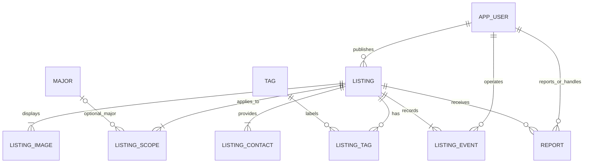

# HUST BookLoop 数据库设计

- 版本：V1.0
- 日期：2026-10-28
- 需求依据：[需求分析文档V1.3](./需求分析文档.md)
- 目标环境：MySQL 8.4，InnoDB，utf8mb4；Java + Spring Boot + Spring Data JPA。
- 建表脚本：[database/schema.sql](./database/schema.sql)
- 基础数据：[database/seed.sql](./database/seed.sql)
- 状态：设计稿与建表脚本已形成，尚未在真实MySQL实例执行验证。

## 1. 设计范围

首期设计10张表，覆盖账户、资料发布、专业学期范围、标签、图片、联系信息、状态记录及举报。没有ISBN、培养方案、教材主数据、课程表、支付订单、物流和聊天表。

一条资料记录代表一个独立流转单位，例如一本书或整体出售的一套复习资料。同名书可以存在多条记录，不按书名合并库存。课程为可空文本字段。

| 表名                | 中文名称     | 主要职责                                     |
| ------------------- | ------------ | -------------------------------------------- |
| `app_user`        | 用户         | 账号、密码哈希、角色、默认联系方式     |
| `major`           | 专业         | 管理具体专业的名称和启用状态                 |
| `tag`             | 标签         | 管理四六级、雅思等标签                       |
| `listing`         | 资料         | 发布者、内容、价格、交易进度和管理限制       |
| `listing_scope`   | 适用范围     | 每行保存一组专业范围与学期                   |
| `listing_tag`     | 资料标签关联 | 资料与标签的多对多关系                       |
| `listing_image`   | 资料图片     | 文件存储位置、大小、类型和展示顺序           |
| `listing_contact` | 资料联系方式 | 发布时保存的联系方式，与个人默认联系方式独立 |
| `listing_event`   | 资料状态记录 | 操作人、动作、操作前后状态及原因             |
| `report`          | 举报         | 举报内容、处理状态和处理结果                 |

类别、学期、成色、笔记情况和角色是固定枚举，使用英文代码保存，在Java和页面中映射中文。专业和标签可维护，分别建表。不使用中文枚举作为业务代码，也不保存Java枚举序号。

## 2. ER图



图中资料至少有一组适用范围、一张图片和一种联系方式，这是发布事务必须满足的业务约束；仅靠子表外键不能保证父记录一定具有子记录。发布成功还必须生成一条PUBLISH日志。

## 3. 通用约定

- 主键使用有符号`BIGINT AUTO_INCREMENT`，Java映射为`Long`；不使用用户输入作为主键。
- 金额使用`DECIMAL(6,2)`，Java使用`BigDecimal`。接口提前拒绝超过两位小数的金额，不依赖数据库舍入。
- 时间使用`DATETIME(3)`。应用与连接会话统一UTC，页面显示时转为Asia/Shanghai；DATETIME本身不携带时区。
- `created_at`表示创建时间；`updated_at`表示最后变更时间。资料另用`published_at`保存首次发布的时间，普通编辑和重新上架都不改变它。
- 可选文本未填写时规范化为NULL，展示“未填写”或省略；必填字段去除首尾空白后校验。
- 用户名限定字母、数字、下划线，登录与注册统一规范化为小写。唯一索引保证不重复，展示名称直接使用账号。
- 对非ASCII字段，应用按Unicode码点数限制长度，与数据库CHAR_LENGTH口径一致；前端UTF-16长度检查不能替代服务端校验。
- 所有外键采用默认RESTRICT策略，不自动级联删除历史记录。资料下架而不物理删除；专业和标签优先停用。
- `row_version`用于并发控制；子表变更也应锁定或更新所属资料的版本，不能绕过父记录的并发保护。

## 4. 数据字典

以下列出业务字段；精确类型、索引和约束以SQL脚本为准。除明确说明允许空值外，字段均必填或由系统生成。

### 4.1 app_user：用户

| 字段                    | 类型               | 说明                                              |
| ----------------------- | ------------------ | ------------------------------------------------- |
| id                      | BIGINT             | 用户主键                                          |
| username                | VARCHAR(40)        | 唯一账号；首期注册校验4—20位                     |
| password_hash           | VARCHAR(255)       | Spring Security密码编码器产生的单向哈希，禁止明文 |
| role                    | VARCHAR(16)        | USER或ADMIN，注册只能创建USER                     |
| default_contact_type    | VARCHAR(16)，可空  | WECHAT、QQ、PHONE                                 |
| default_contact_value   | VARCHAR(100)，可空 | 与类型同时为空或同时有值                          |
| created_at / updated_at | DATETIME(3)        | 创建、更新时间                                    |

账户不保存专业学籍认证信息。管理员通过受限初始化流程创建，种子SQL不含默认账号或密码。权限由服务端校验，不能信任前端提交的role。

### 4.2 major、tag：基础选项

| 字段                    | 类型                      | 说明                       |
| ----------------------- | ------------------------- | -------------------------- |
| id                      | BIGINT                    | 稳定标识；修改名称不改变ID |
| name                    | VARCHAR(40) / VARCHAR(30) | 专业／标签名称，各表内唯一 |
| enabled                 | BOOLEAN                   | 是否允许新增关联           |
| created_at / updated_at | DATETIME(3)               | 创建、更新时间             |

“不限专业”不作为major表的一行保存，避免被停用或删除。专业及标签停用后，历史关联继续显示；用户编辑已有资料时允许保留原关联，但不能新增停用选项的关联。重命名通过外键自动关联到新名称。

### 4.3 listing：资料

| 字段                      | 类型               | 说明                                                         |
| ------------------------- | ------------------ | ------------------------------------------------------------ |
| id / owner_id             | BIGINT             | 资料ID／发布者外键                                           |
| title                     | VARCHAR(100)       | 标题或书名，不能为空白                                       |
| category                  | VARCHAR(16)        | TEXTBOOK教材、READING推荐阅读、EXAM考试资料                  |
| author / publisher        | VARCHAR(100)，可空 | 作者、出版社                                                 |
| edition_note              | VARCHAR(100)，可空 | 版次、适用年份或版本说明                                     |
| course_name               | VARCHAR(100)，可空 | 课程或考试名称，不建立课程外键                               |
| description               | VARCHAR(2000)，可空 | 内容、缺损、套装组成等；未填写时为NULL                       |
| condition_code            | VARCHAR(16)        | LIKE_NEW近全新、LIGHT_USE轻微使用、HEAVY_USE明显使用         |
| note_level                | VARCHAR(16)        | NONE无笔记、FEW少量、MANY大量                                |
| transfer_type             | VARCHAR(16)        | SALE出售、GIFT免费赠送                                       |
| price                     | DECIMAL(6,2)       | 出售为0.01—9999.99；赠送固定0                               |
| lifecycle_status          | VARCHAR(16)        | ACTIVE可获取、RESERVED预订、COMPLETED完成、WITHDRAWN主动下架 |
| admin_blocked             | BOOLEAN            | 是否被管理员下架；独立于交易进度                             |
| admin_reason              | VARCHAR(500)，可空 | 管理下架时必填，解除后可保留最近原因，完整历史见日志         |
| completed_at              | DATETIME(3)，可空  | COMPLETED时必须有值，其他状态为空                            |
| row_version               | BIGINT             | 并发版本号，初始0                                            |
| published_at / updated_at | DATETIME(3)        | 首次发布时间／最近修改时间                                   |

不设置订单号、买家ID和支付状态。当前预订仅表示发布者已在线下约定留书，平台不管理买家的预订资格。

### 4.4 listing_scope：专业与学期组合

| 字段            | 类型           | 说明                                      |
| --------------- | -------------- | ----------------------------------------- |
| id / listing_id | BIGINT         | 范围ID／所属资料                          |
| scope_type      | VARCHAR(16)    | ALL不限专业、SPECIFIC具体专业             |
| major_id        | BIGINT，可空   | ALL时必须NULL；SPECIFIC时引用有效专业     |
| semester_code   | VARCHAR(16)    | 固定学期代码                              |
| major_key       | BIGINT，生成列 | 将NULL映射为0，仅用于组合去重，Java不写入 |

学期代码如下：

| 页面选项   | 数据库代码   |
| ---------- | ------------ |
| 大一上／下 | Y1_S1／Y1_S2 |
| 大二上／下 | Y2_S1／Y2_S2 |
| 大三上／下 | Y3_S1／Y3_S2 |
| 大四上／下 | Y4_S1／Y4_S2 |
| 大五上／下 | Y5_S1／Y5_S2 |
| 研究生     | POSTGRAD     |
| 未定义     | UNDEFINED    |

查询中的“不限学期”不保存为数据值，而是不加学期条件。“未定义”是明确的数据值，必须精确匹配。

例如同一本书适用于“计算机科学与技术＋大二上”和“物联网工程＋大二下”，需保存两行。筛选“物联网工程＋大二上”不能命中它。

唯一键`(listing_id, major_key, semester_code)`防止重复组合，包括“不限专业＋未定义”。不能直接依赖包含NULL的major_id唯一键防止不限专业重复。

### 4.5 listing_tag：标签关联

`listing_id`与`tag_id`组成复合主键，并分别引用listing和tag，防止同一资料重复添加同一标签。资料允许没有任何标签。增加`(tag_id, listing_id)`索引用于反向筛选。

### 4.6 listing_image：资料图片

| 字段            | 类型         | 说明                                           |
| --------------- | ------------ | ---------------------------------------------- |
| id / listing_id | BIGINT       | 图片ID／所属资料                               |
| storage_key     | VARCHAR(255) | 服务端生成的相对存储键，唯一；不保存图片二进制 |
| mime_type       | VARCHAR(32)  | JPEG、PNG或WebP的实际校验类型                  |
| byte_size       | INT          | 1—5242880字节                                 |
| sort_order      | TINYINT      | 1—6，同一资料内唯一；最小序号为封面           |
| created_at      | DATETIME(3)  | 保存时间                                       |

资料至少一张图片由发布事务校验。序号范围和唯一索引共同限制最多6张。编辑时在事务中替换图片关联或重新分配序号，避免交换1、2号时直接更新造成唯一键冲突。文件名、扩展名和MIME声明都不能替代文件内容校验。

### 4.7 listing_contact：条目联系方式

| 字段            | 类型         | 说明                 |
| --------------- | ------------ | -------------------- |
| id / listing_id | BIGINT       | 联系方式ID／所属资料 |
| contact_type    | VARCHAR(16)  | WECHAT、QQ、PHONE    |
| contact_value   | VARCHAR(100) | 联系账号，不能为空白 |

同一资料每种方式最多一条，至少一种由业务校验。首期表单虽然只输入一种，表结构允许将来提供多种。发布时可从用户默认联系方式复制，但不是动态读取默认值；用户修改默认联系方式不改变历史条目。

独立成表有利于公开列表避免查询联系方式。后端还需使用明确DTO投影，禁止直接序列化JPA实体导致联系方式或密码泄露。未登录不查询联系方式；已完成或下架时，只有所有者和管理员可按管理权限查看。

### 4.8 listing_event：状态和流转方式记录

| 字段                       | 类型               | 说明                       |
| -------------------------- | ------------------ | -------------------------- |
| id / listing_id / actor_id | BIGINT             | 日志、资料、操作用户       |
| actor_role                 | VARCHAR(16)        | 操作当时的角色快照         |
| action_code                | VARCHAR(24)        | 操作类型，见下文           |
| before_snapshot            | JSON，可空         | 操作前状态，首次发布为NULL |
| after_snapshot             | JSON               | 操作后状态                 |
| reason                     | VARCHAR(500)，可空 | 下架、解除等原因           |
| created_at                 | DATETIME(3)        | 操作时间                   |

操作类型为PUBLISH、RESERVE、CANCEL_RESERVATION、COMPLETE、WITHDRAW、RELIST、CHANGE_TRANSFER、ADMIN_BLOCK、ADMIN_RELEASE。

快照固定结构包含`lifecycleStatus`、`transferType`、`price`（十进制字符串）、`adminBlocked`、`completedAt`、`rowVersion`，不包含密码、联系方式或图片内容。JSON用于保存当时事实，核心筛选仍使用listing上的结构化字段；应用必须校验快照结构。只追加，不通过普通管理页面编辑或删除日志。

### 4.9 report：举报

| 字段                          | 类型               | 说明                                                                      |
| ----------------------------- | ------------------ | ------------------------------------------------------------------------- |
| id / listing_id / reporter_id | BIGINT             | 举报、资料、举报者                                                        |
| reason_code                   | VARCHAR(24)        | INACCURATE信息不准确、FALSE_LISTING虚假、INAPPROPRIATE不当内容、OTHER其他 |
| description                   | VARCHAR(500)，可空 | 补充说明                                                                  |
| status                        | VARCHAR(16)        | PENDING待处理、RESOLVED已处理、REJECTED驳回                               |
| handler_id                    | BIGINT，可空       | 处理管理员                                                                |
| resolution_note               | VARCHAR(500)，可空 | 处理结果说明，处理后必填                                                  |
| created_at / handled_at       | DATETIME(3)        | 创建时间／处理时间（待处理时为空）                                        |
| row_version                   | BIGINT             | 防止多人重复处理                                                          |
| pending_key                   | TINYINT，生成列    | 待处理为1，其他为NULL，Java不写入                                         |

唯一键`(listing_id, reporter_id, pending_key)`阻止同一用户对同一条目产生两条待处理举报，同时允许保存已处理历史及不同用户的举报。是否举报本人资料、是否可访问、处理人是否为管理员，均由服务端验证。

RESOLVED必须在一个事务内将关联资料设为管理员限制并写入`ADMIN_BLOCK`日志；REJECTED只更新举报处理结果和处理理由，不改变资料状态、既有管理员限制或下架原因。

## 5. 状态模型与页面映射

数据库把交易进度与管理限制分开，页面仍显示需求文档的六种状态。

| admin_blocked | lifecycle_status | transfer_type | 页面状态             |
| ------------- | ---------------- | ------------- | -------------------- |
| 1             | 任意             | 任意          | 已下架（管理员限制） |
| 0             | ACTIVE           | SALE          | 在售                 |
| 0             | ACTIVE           | GIFT          | 待赠送               |
| 0             | RESERVED         | 任意          | 已预订               |
| 0             | COMPLETED        | SALE          | 已售出               |
| 0             | COMPLETED        | GIFT          | 已送出               |
| 0             | WITHDRAWN        | 任意          | 已下架（发布者操作） |

业务规则：

1. 发布成功为ACTIVE；赠送自动设price=0，出售校验正价。
2. ACTIVE可转RESERVED、COMPLETED或WITHDRAWN。
3. RESERVED可取消为ACTIVE、完成为COMPLETED或转WITHDRAWN；不能修改流转方式。
4. WITHDRAWN仅在未被管理员限制时可重新上架为ACTIVE。
5. COMPLETED不可编辑、改变流转方式或重新上架；完成时间保留。
6. 管理员下架只设置admin_blocked=1并记录原因，不改交易进度。
7. 解除管理员限制时：COMPLETED保持COMPLETED；其余状态统一转WITHDRAWN，再由发布者决定是否上架，不能自动重新公开。
8. 修改出售／赠送方式仅允许未被限制的ACTIVE或WITHDRAWN，价格同步更新；记录前后方式和价格。

例如：一条已售出记录被管理员下架后，数据库仍然是`COMPLETED + SALE`，只是admin_blocked=1；解除限制后仍显示已售出，永远不能因为解除限制而变成在售。

数据库CHECK保证当前行合法，但不能判断“从哪个旧状态转换而来”。终态不可逆、所有权、管理员角色和流程转换必须由事务中的服务代码保证。

## 6. 查询与索引

### 6.1 市场列表

仅查询`admin_blocked=0 AND lifecycle_status='ACTIVE'`。按`published_at DESC, id DESC`排序，以id作为稳定次排序；价格排序同样以id打破并列。页大小默认20。

用同一个EXISTS子查询同时校验专业和学期，用另一个EXISTS校验多选标签，避免多对多JOIN将书籍重复展开。以下为参数化查询示意，不是可直接执行的种子脚本：

```sql
SELECT l.id, l.title, l.category, l.transfer_type, l.price, l.published_at
FROM listing l
WHERE l.admin_blocked = 0 AND l.lifecycle_status = 'ACTIVE'
  AND EXISTS (
      SELECT 1 FROM listing_scope s
      WHERE s.listing_id = l.id
        AND (s.scope_type = 'ALL' OR s.major_id = :majorId)
        AND s.semester_code = :semesterCode
  )
  AND EXISTS (
      SELECT 1 FROM listing_tag lt
      WHERE lt.listing_id = l.id AND lt.tag_id IN (:tagIds)
  )
ORDER BY l.published_at DESC, l.id DESC
LIMIT :pageSize OFFSET :offset;
```

- 全部专业：省略专业条件；只选不限专业：使用scope_type='ALL'。
- 具体专业：匹配该major_id或ALL；学期条件必须留在同一子查询。
- 不限学期：省略学期条件；未定义：精确匹配UNDEFINED。
- 无标签筛选：整个标签EXISTS省略，避免空IN列表。
- 多选标签：IN表示任一标签匹配。
- 不过滤停用的专业或标签，确保历史关联仍可被查询。
- 免费赠送参与价格筛选时按0处理，不需要专门的“免费”金额类型。

关键词首期使用参数化LIKE对标题、作者、课程及标签名匹配；按普通文本搜索时转义用户输入的`%`、`_`和转义字符。`LIKE '%词%'`不能假设能使用普通B-tree索引加速，应在需求的数据量上实测；首期不引入搜索引擎。

### 6.2 其他查询

| 场景     | 索引及策略                                         |
| -------- | -------------------------------------------------- |
| 我的发布 | owner_id + published_at + id，再按映射后的状态筛选 |
| 资料详情 | 主键查询；检查公开性或所有者／管理员权限           |
| 图片展示 | listing_id + sort_order，最小序号为封面            |
| 标签筛选 | tag_id + listing_id                                |
| 状态记录 | listing_id + created_at + id                       |
| 举报队列 | status + created_at + id                           |

不为每种组合条件建立索引；先保留主要查询路径，后续通过EXPLAIN和性能测试判断是否增加索引。列表获取封面时使用批量查询或明确投影，避免逐条触发JPA懒加载形成N+1查询。

## 7. 事务与并发

### 7.1 发布与编辑

1. 校验登录用户及字段，检查至少一组范围、1—6张图片和至少一种联系方式。
2. 在事务中校验专业、标签是否启用；允许编辑时保留原有停用关联，但禁止新增。基础选项检查与新增关联需使用约定的锁顺序，避免管理员停用与新增操作同时通过。
3. 保存listing及范围、标签、图片、联系方式；首次发布写PUBLISH事件。任一步失败整体回滚。
4. 文件先进入临时区域，验证后生成服务端存储键；提交前确保目标文件已准备好，事务失败清理未引用文件，事务提交后再删除旧文件。数据库事务不能自动回滚文件系统操作，需补偿与定期清理。

### 7.2 状态变更

使用`@Transactional`。读取当前资料并核对操作者、状态及row_version，计算新状态，更新资料和追加日志放在同一事务。可以使用JPA `@Version`乐观锁；出现冲突时返回“资料已更新，请刷新”，不自动用旧输入覆盖新状态。

所有子表编辑、图片调整和联系方式修改也必须经过资料聚合的版本检查。完整替换子表时建议锁定父记录，采用统一策略防止并发编辑互相覆盖。

### 7.3 举报处理

使用举报版本或行锁防止两名管理员重复处理。涉及下架时按统一顺序获取资料锁、举报锁，更新资料、日志及举报结果，任一步失败全部回滚。提交举报的唯一索引冲突应转换为友好提示，而不是暴露SQL异常。

## 8. 安全与持久化边界

- 不保存明文密码，不将密码哈希、联系方式放入公开列表DTO。
- 用户默认联系方式与条目联系方式分别保存，绝不由前端控制owner_id或actor_id。
- 管理员角色不能由普通注册、个人资料接口修改。
- 本设计不保存登录session表；首期采用服务端会话，服务重启后允许重新登录。业务数据和图片必须持久保存。
- 数据库备份与图片目录备份需要对应，恢复演练同时覆盖两者。
- 清除页面sessionStorage不影响正式数据库；原型中的演示账号、假联系方式和状态数据不自动导入生产数据库。

## 9. 建库与Java接入顺序

1. 由部署人员创建空库`hust_bookloop`及最小必要权限的应用账号，选择该库。
2. 执行schema.sql，再执行seed.sql。两个文件面向首次初始化，不会DROP已有表，也不承诺可重复执行。
3. 验证外键、CHECK、唯一键和初始化数据。不要在已有业务数据的库中反复运行首次建表脚本。
4. 建立实体与Repository。枚举使用STRING映射，生成列配置为不插入不更新；金额使用BigDecimal，row_version使用@Version。
5. 开发时以版本化SQL迁移管理结构，JPA配置优先使用validate核对结构，不靠自动update长期修改数据库。
6. 先实现账户及资料查询，再接发布事务、图片、状态和后台管理。

可在MySQL客户端内使用：

```sql
CREATE DATABASE hust_bookloop CHARACTER SET utf8mb4 COLLATE utf8mb4_0900_ai_ci;
USE hust_bookloop;
SOURCE /absolute/path/to/database/schema.sql;
SOURCE /absolute/path/to/database/seed.sql;
```

连接账号、密码和连接地址放入环境配置，不写入代码仓库。以上步骤尚未在当前环境执行，未创建实际数据库。

## 10. 待执行验证清单

- 出售零价、赠送非零价、无效枚举应被拒绝；接口拒绝多于两位小数。
- 不限专业的major_id必须NULL，具体专业必须存在；相同不限专业学期不能重复保存。
- 同一资料标签不能重复；第7张图片、超限文件大小及重复顺序应被拒绝。
- 同用户同条目不能有两条待处理举报；不同用户可以举报同一条目；处理后允许保留历史并再次举报。
- 未完成记录不能携带completed_at，完成记录不能缺失完成时间。
- 已完成条目经过管理下架、解除后仍不能上架。
- 并发预订、售出、管理员下架不能使旧状态覆盖新状态；日志与业务记录一致。
- 发布任一子表失败时不得留下不完整公开条目；删除旧图片失败需进入补偿清理。
- 筛选具体专业包含不限专业，专业学期不跨组匹配，多标签结果不重复。
- 用户只能修改自己的资料，联系方式按权限提供。

## 11. 技术依据

建表、索引、外键和CHECK使用MySQL官方支持的语法；详细约束行为参考[MySQL 8.4 CREATE TABLE](https://dev.mysql.com/doc/refman/8.4/en/create-table.html)和[外键约束](https://dev.mysql.com/doc/refman/8.4/en/create-table-foreign-keys.html)。生成列用于处理可空字段的组合唯一性，不能由应用手工写入。

若改用旧版本，必须核实CHECK是否实际执行；MySQL从8.0.16起支持执行相关CHECK约束，见[官方CHECK文档](https://dev.mysql.com/doc/refman/8.0/en/create-table-check-constraints.html)。本项目脚本统一以8.4为验证目标，不建议在未验证情况下跨数据库直接使用。
